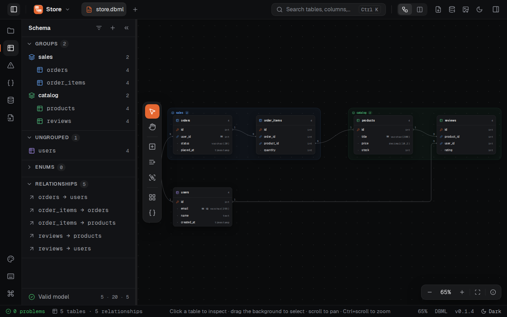
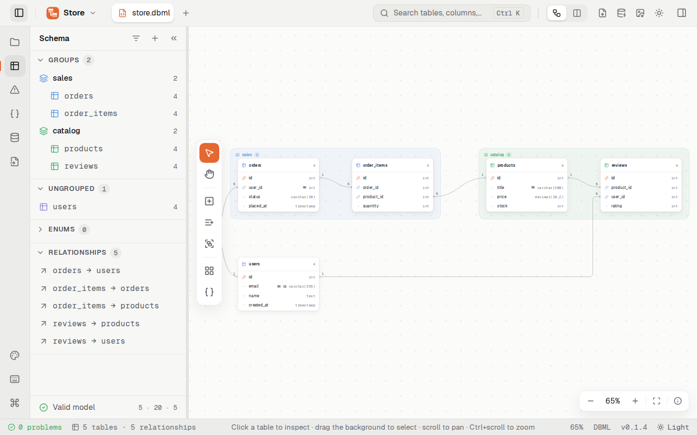
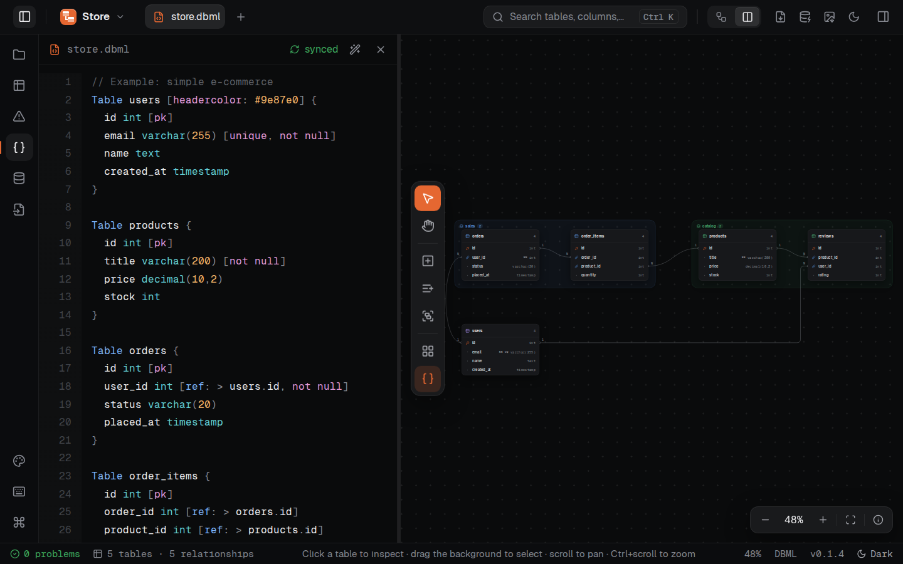

<div align="center">


# DB Modeling

**Visual relational database modeling in a fast, native desktop app, interactive web CLI, and VS Code extension. Built in Rust with GPUI and WebAssembly — no Electron, 100% local-first, and pure DBML as the single source of truth.**

[Download](https://github.com/dbmodeling/dbml/releases) · [Highlights](#highlights) · [Installation](#installation--usage) · [Running & Building](#running--building) · [Contributing](#contributing)

[](LICENSE)
[](https://www.rust-lang.org/)

</div>

<p align="center">
  
  
</p>
<p align="center">
  
</p>

---

The screenshots show the Web CLI workbench. The VS Code extension shares this interface. The desktop app renders its workbench in GPUI.

[Architecture](docs/03-arquitetura.md) · [Workbench guide](docs/05-ux.md) · [Visual identity](docs/identidade-visual.md)

## Why DB Modeling

Most visual database modeling tools either lock your schemas inside a cloud web app or run inside a heavy Electron wrapper. **DB Modeling** renders its desktop UI natively on the GPU with **GPUI** and compiles the exact same Rust core to **WebAssembly** for the browser CLI and VS Code — keeping `.dbml` files 100% pure, local, and Git-friendly.

| Capability | DB Modeling | Cloud ERD Tools | Electron-based Tools |
| :--- | :--- | :--- | :--- |
| **Native desktop rendering** | Yes (GPUI, GPU-accelerated) | No (browser tab) | No (embedded Chromium) |
| **Runs offline / local-first** | Yes | Limited / requires account | Yes |
| **Pure `.dbml` source of truth** | Yes (`dbdiagram.io` compatible) | Often proprietary | Varies |
| **Git-friendly layout metadata** | Deterministic `.layout.json` | Cloud-only | Mixed into schema |
| **Desktop + Web CLI + VS Code** | Yes (shared Rust + Wasm core) | Web only | Desktop only |
| **Telemetry or external servers** | None | Yes | Varies |

---

## Highlights

- **Strict DBML as the single source of truth** — `.dbml` files stay 100% pure and compatible with `dbdiagram.io`. Positions and colors are saved in a deterministic `<file>.dbml.layout.json` sidecar with sorted keys for clean Git diffs.
- **Shared modeling workflow across Desktop, Browser, and VS Code** — Shared Rust core (`schema`, `dbml-syntax`, `dbml-analysis`, `dbml-edit`, `layout`) compiled to native GPUI and WebAssembly (`dbml-wasm` + `canvas-web`), with the same Topbar, Sidebar, Canvas, Inspector, DBML Editor, Command Palette (`Ctrl+K`), and Shortcuts (`Ctrl+/`).
- **Bidirectional real-time editing** — Edit in the DBML editor or visually on the canvas (tables, columns, `PK`/`NOT NULL`/`UNIQUE`, groups, drag-to-connect `Ref:` foreign keys). Visual edits generate minimal textual patches (`dbml-edit`) preserving comments and formatting.
- **Deterministic layout and relation routing** — Automatic placement, column-to-column relations, cardinality labels and obstacle avoidance.
- **High-resolution Export** — Export diagrams to **PNG (2x)** and **SVG** with optional title, color legend, and light/dark themes.

---

## Installation & Usage

- **Windows:** Download `db-modeling-windows-setup.exe` from [GitHub Releases](https://github.com/dbmodeling/dbml/releases) and run the installer.
- **macOS:** Download the `.dmg` / `.pkg` installer from [GitHub Releases](https://github.com/dbmodeling/dbml/releases).
- **Linux (Ubuntu / Debian / Fedora):** Download the `.deb` or `.rpm` from [GitHub Releases](https://github.com/dbmodeling/dbml/releases), or run:
  ```bash
  curl -fsSL https://github.com/dbmodeling/dbml/releases/latest/download/db-modeling-install.sh | bash
  ```
- **Interactive Web CLI (`dbml`):** Start a local HTTP + WebSocket server with live reload and two-way persistence:
  ```bash
  dbml path/to/schema.dbml
  # Options: --port 3000 --no-open --no-watch
  ```
- **Docker (Self-Hosted Web Server):** Run the `dbml` web server in a container without installing Rust or Node.js:
  ```bash
  # Build the image (compiles Wasm, canvas-web, and the dbml CLI binary)
  docker build -t dbml-web .

  # Run and mount your local .dbml directory into /workspace
  docker run -p 3000:3000 -v "$(pwd):/workspace" dbml-web

  # Or use Docker Compose (mounts ./schemas -> /workspace by default)
  docker compose up --build
  ```
  The startup logs print the session URL (`http://127.0.0.1:3000/?token=...`). All edits to `.dbml` files and `.dbml.layout.json` sidecars are persisted directly to the mounted host directory. Health status is exposed at `GET /health`.
- **VS Code Extension:** Open any `.dbml` file using the **DB Modeling** custom editor (`vscode-extension/`).

---

## Running & Building

Sync and build all targets (Rust core, Wasm, Web CLI, VS Code extension, and Desktop app):

```bash
git clone https://github.com/dbmodeling/dbml.git
cd dbml
./scripts/sync-build.sh --release
```

Run individual targets directly:

```bash
# Native Desktop App (crates/app)
cargo run -p app --release -- path/to/schema.dbml

# Interactive Web CLI (crates/cli)
cargo run -p dbml-cli -- path/to/schema.dbml
# Options: --port 3000 --no-open --no-watch

# Import SQL DDL (postgres, mysql, sqlite) into DBML:
cargo run -p dbml-cli -- import schema.sql --dialect postgres -o schema.dbml

# Export DBML to SQL DDL (postgres, mysql, sqlite, sqlserver, oracle):
cargo run -p dbml-cli -- export schema.dbml --format sql --dialect postgres -o schema.sql

# Structural diff between two DBML files (exit 0 = same, 1 = differences, 2 = error):
cargo run -p dbml-cli -- diff old.dbml new.dbml [--format json]
```

- **Ubuntu / Debian dependencies:** `build-essential pkg-config cmake libxcb1-dev libxcb-render0-dev libxcb-shape0-dev libxcb-xfixes0-dev libxkbcommon-dev libxkbcommon-x11-dev libwayland-dev libvulkan-dev libfontconfig1-dev libssl-dev`
- **VS Code Extension:** `cd vscode-extension && npm run compile` (or `npx @vscode/vsce package` for `.vsix`)
- **Native Installers (`scripts/`):** `./scripts/build-deb.sh`, `./scripts/build-fedora.sh`, `./scripts/build-macos.sh`, `./scripts/build-windows.sh`

---

## Contributing

Contributions are welcome! See [CONTRIBUTING.md](CONTRIBUTING.md) for the workspace layout, architecture rules, and CI checks (`cargo fmt`, `cargo clippy`, `cargo test`, and `./scripts/sync-build.sh`).

---

## Security & License

Free code signing provided by [SignPath.io](https://about.signpath.io/), using a certificate by [SignPath Foundation](https://signpath.org/). DB Modeling runs locally with zero telemetry — see [SECURITY.md](SECURITY.md) for details.

Licensed under the **[Apache License 2.0](LICENSE)**: free to use, modify and distribute, including commercially, provided the license text and copyright notice are kept. Copyright (c) 2026 Samuel Viana da Silva.
