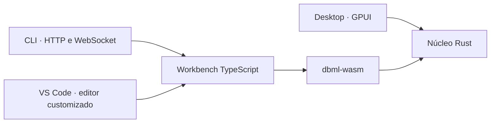

# 03 — Arquitetura

## Visão geral



O [workbench](05-ux.md) reúne o editor DBML, o diagrama, a navegação do
esquema e o inspetor. Desktop e Web têm renderizadores próprios e compartilham
as operações de modelagem e a geometria do núcleo.

## Estrutura do monorepo

```text
crates/
  core/
    schema/         # modelo semântico
    dbml-syntax/    # lexer e parser tolerante, com CST sem perdas
    dbml-analysis/  # projeção do CST, diagnósticos e autocomplete
    dbml-edit/      # comandos semânticos que produzem patches textuais
    layout/         # posicionamento, roteamento e geometria
  db-introspect/    # leitura de esquemas de bancos de dados
  sql-import/       # conversão de DDL para DBML
  diagram-export/   # exportação de diagramas
  dbml-wasm/        # ponte do Rust para o navegador e o VS Code
  app/             # aplicativo desktop GPUI
  cli/             # binário dbml, servidor HTTP e WebSocket
packages/
  canvas-web/      # canvas e workbench compartilhados pela CLI Web e pelo VS Code
vscode-extension/  # editor customizado, sidebar e integração com o VS Code
```

Os crates em `crates/core/` tratam do modelo, do texto DBML e da geometria. O
desktop os consome diretamente. O canvas compartilhado acessa o núcleo via
`dbml-wasm`. Só o crate `app` depende de GPUI.

O script `./scripts/sync-build.sh` compila a ponte Wasm e atualiza o bundle
embutido em `crates/cli/web/` e o bundle em `vscode-extension/dist/`.

O workflow de release gera instaladores para Windows, Linux e macOS Apple Silicon.

## Edição do documento

O arquivo `.dbml` contém o modelo. O parser `dbml-syntax` produz um CST sem
perdas, e `dbml-analysis` deriva o `Schema` e os diagnósticos. Quando o usuário
edita uma tabela no diagrama ou no inspetor, o workbench envia um comando
semântico a `dbml-edit`. O comando retorna um patch localizado no texto, que
volta ao mesmo fluxo de análise do editor de código.

## Renderização do workbench

| Responsabilidade | Desktop | CLI Web e VS Code |
|---|---|---|
| Composição e painéis | [shell](../crates/app/src/shell/) | [workbench.ts](../packages/canvas-web/src/workbench.ts) |
| Diagrama e interação | [canvas.rs](../crates/app/src/canvas.rs) | [canvas-view.ts](../packages/canvas-web/src/canvas-view.ts) e [renderer.ts](../packages/canvas-web/src/renderer.ts) |
| Cores e superfícies | [glass.rs](../crates/app/src/glass.rs) | [glass.ts](../packages/canvas-web/src/glass.ts) |
| Atalhos e paleta | [actions.rs](../crates/app/src/actions.rs) | [actions.ts](../packages/canvas-web/src/actions.ts) |

O desktop usa elementos GPUI. O workbench web usa HTML e CSS para os cartões
e SVG para as relações. O crate [layout](../crates/core/layout/src/lib.rs)
fornece a geometria dos cartões, o posicionamento e as rotas. A ponte Wasm
entrega a cena ao workbench web com posições e caminhos das relações. Os
tokens estão detalhados na [identidade visual](identidade-visual.md).

## Exportação

No desktop, `diagram-export` monta SVG e rasteriza a imagem com
`resvg`/`tiny-skia`. Na Web, [export.ts](../packages/canvas-web/src/export.ts)
monta SVG a partir da cena e usa as APIs de imagem do navegador para
rasterizar. O código SQL é gerado a partir do modelo pelo núcleo Rust.

### Mermaid `erDiagram`
Tradução direta do `Schema` (layout é ignorado — Mermaid faz o próprio):

| DBML | Mermaid |
|---|---|
| `Table users { … }` | `users { … }` |
| coluna `email varchar(255) [unique, not null]` | `varchar email UK` (tipo sanitizado) |
| `[pk]` / FK / `[unique]` | `PK` / `FK` / `UK` (combináveis) |
| `note` da coluna | comentário `"…"` do atributo |
| `Ref: posts.author_id > users.id` (FK not null) | `users \|\|--o{ posts : "author_id"` |
| FK anulável | lado "um" vira `\|o` (zero ou um) |
| `1-1`, `N-N` | `\|\|--\|\|`, `}o--o{` |
| enums, índices, defaults, TableGroups, cores | **sem equivalente** → avisados no painel de export (enum pode virar comentário) |

Nomes/tipos com caracteres que Mermaid não aceita são sanitizados de forma
determinística. Validar a saída contra o parser oficial do Mermaid nos testes (CLI
`mmdc`, opcional no CI).

## Persistência e transporte

- **Sidecar.** `schema.dbml.layout.json` fica ao lado de `schema.dbml` e
  guarda dados visuais como posições e estilos de relações, com chaves ordenadas.
- **Desktop.** O shell gerencia o documento aberto. A persistência local da
  sessão e das preferências passa por `session.rs` e `settings.rs`.
- **CLI Web.** [WebSocketTransport](../packages/canvas-web/src/transport.ts)
  envia patches e pedidos de salvamento ao servidor Axum. O
  [servidor](../crates/cli/src/server.rs) verifica o arquivo ativo e, em
  alterações de texto, compara a versão esperada antes de salvar.
- **VS Code.** `VsCodeTransport` usa mensagens do webview. O
  [editor customizado](../vscode-extension/src/customEditor.ts) aplica
  os patches ao documento do VS Code e escreve o sidecar pela API do workspace.

## Validação

`cargo test --workspace` cobre as bibliotecas e os alvos Rust.
`npm --prefix packages/canvas-web test` cobre o workbench compartilhado.
`./scripts/sync-build.sh` reconstrói a ponte e os bundles usados pela CLI Web
e pelo VS Code e verifica a compilação dos binários Rust.
