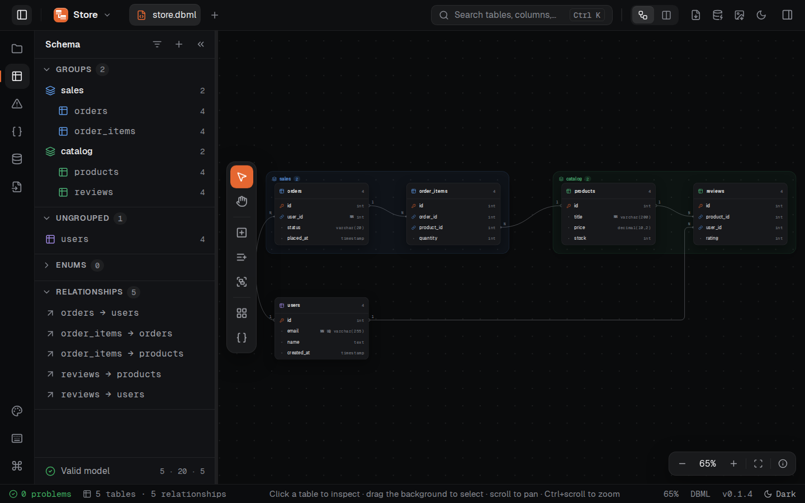
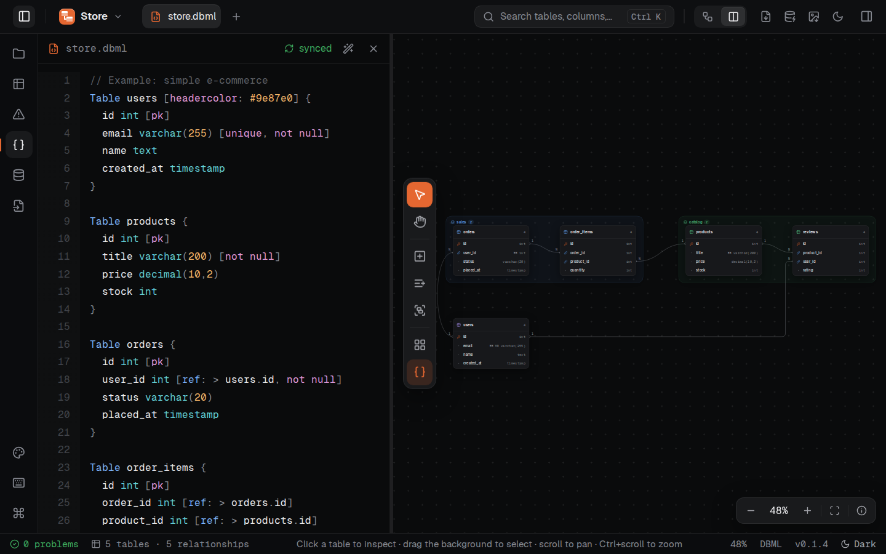

# 05 — Workbench e fluxos de trabalho

## Área de trabalho

A barra superior reúne busca e comandos, modos de visualização, exportação e tema.
A barra de atividades dá acesso a arquivos, esquema, problemas e editor DBML.
O diagrama ocupa o centro. O inspetor mostra os detalhes da seleção quando aberto.
As ferramentas de modelagem e os controles de zoom ficam em barras flutuantes.

As capturas deste guia foram feitas no workbench da **CLI Web** com o esquema de
exemplo em [crates/app/assets/sample.dbml](../crates/app/assets/sample.dbml).
A extensão usa o mesmo workbench no webview. O desktop implementa a interface
em GPUI e usa os diálogos e a integração de arquivos do sistema.

## Modelar no diagrama

1. Use **Nova tabela** na barra de ferramentas ou pressione `T`.
2. Selecione uma tabela para abrir seus detalhes no inspetor e editar colunas, notas e índices.
3. Arraste a porta de uma coluna até a coluna de destino para criar uma relação.
4. Selecione tabelas e use **Agrupar seleção** para organizar o esquema visualmente.

A organização automática (`Ctrl+L`) reposiciona as tabelas. **Ajustar à tela**
(`Shift+1`) muda a ampliação e o enquadramento. O diagrama desenha relações entre
colunas com rótulos de cardinalidade. A rota automática usa uma curva quando
há espaço e pode contornar cartões que bloqueiem o caminho.

## Editar DBML e conferir diagnósticos

**Diagrama** (`Ctrl+1`) e **Dividido** (`Ctrl+2`) alternam a composição do
workbench. A ação **Editor DBML** (`Ctrl+E`) abre o texto. O painel de problemas
mostra os diagnósticos do documento. Mudanças estruturais no diagrama alteram o
texto por meio do núcleo de edição, e posições e estilos são salvos no sidecar.

## Importar, exportar e navegar

| Tarefa | Onde encontrar |
|---|---|
| Buscar tabelas, colunas e ações | Busca e paleta de comandos (`Ctrl+K`) |
| Alternar barra lateral ou inspetor | `Ctrl+B` ou `Ctrl+I` |
| Consultar atalhos | Barra de atividades (`Ctrl+/`) |
| Importar SQL DDL ou conectar a um banco | Barra de atividades |
| Exportar DBML, código ou imagem | Ações de exportação na barra superior |
| Alternar tema claro/escuro | Barra superior (`Ctrl+T`) |

## Comparar com o git HEAD (CLI Web e extensão VS Code)

A ação **Comparar com o git HEAD** (`D`, também na paleta `Ctrl+K`) liga o modo
Comparar: a base é a versão do arquivo aberto no `HEAD` do git, e o documento
atual é o head. O modo é somente leitura: não edita o texto, não grava patches e
não entra no histórico de desfazer. Os mesmos atalhos e comandos continuam
valendo, e o diff é recalculado a cada edição (a base fica em memória).

- **Cores e marcadores** (nunca só cor): verde `+` adicionado, âmbar `~`
  modificado, vermelho `−` removido. Tabelas e enums removidos aparecem como
  cartões fantasma translúcidos e tracejados em espaço livre; colunas removidas
  ficam no fim do cartão; relações removidas são arestas tracejadas vermelhas.
- **Resumo** no painel lateral, agrupado em tabelas, colunas, índices, enums e
  relações. Clicar num item seleciona (quando existe no head) e leva a câmera até
  ele. `D` ou `Esc` (sem seleção) sai do modo.
- **Estados**: carregando, sem diferenças, e erros claros (git ausente, fora de
  repositório, repositório sem commits, arquivo novo que ainda não está no
  `HEAD`, DBML inválido em um dos lados) com botão de tentar de novo.

O app desktop ainda não tem este modo.

A disponibilidade das ações de arquivo depende do host. Na extensão, o editor
customizado usa os documentos do VS Code, e a conexão a bancos usa a CLI `dbml`.

## Aparência

Os temas usam superfícies neutras e destaque laranja. Geist aparece nos painéis
e Geist Mono nos trechos de código e tipos de coluna. Veja os tokens, fontes e
assets no [guia de identidade visual](identidade-visual.md).

## Arquivos, instância única e recuperação (app desktop)

- **Mudança externa:** o app confere os arquivos abertos a cada 1,5 s. Aba sem
  edições é recarregada (Desfazer volta ao buffer anterior); aba com edições
  mostra um aviso sem modal, e o primeiro Salvar sobre um arquivo alterado no
  disco avisa antes de sobrescrever (um segundo Salvar confirma).
- **Instância única:** abrir outro `.dbml` entrega o arquivo à janela já aberta.
  Em builds de debug ou com a feature `harness` isso fica desligado.
- **Recuperação:** abas com edições não salvas ganham cópias em
  `<config>/recovery/` (e o panic hook grava antes do abort). Na abertura
  seguinte elas voltam como abas "(recuperado)" sem caminho, para o disco nunca
  ser sobrescrito calado.
- **Layout:** posições das tabelas vão para `<arquivo>.dbml.layout.json`, no
  mesmo formato da CLI Web e do VS Code.
- **Harness de screenshot:** `DBM_SIZE`, `DBM_MODE`, `DBM_SELECT`, `DBM_PANE`,
  `DBM_SIDEBAR`, `DBM_EDITOR` e `DBM_INSPECTOR` só valem em debug ou com
  `--features harness`.

## Acessibilidade e limitação conhecida (app desktop)

Todas as ações do app desktop têm atalho de teclado e aparecem na paleta de
comandos (`Ctrl+K`), e os controles expõem papel e rótulo (`role`/`aria_label`)
ao GPUI. Mesmo assim, o **GPUI ainda não publica uma árvore de acessibilidade
para o sistema operacional** (UI Automation no Windows, AT-SPI no Linux,
NSAccessibility no macOS). O app desktop, portanto, é opaco para leitores de tela
como NVDA, Orca e VoiceOver: a navegação por teclado funciona, mas o conteúdo não
é lido em voz alta.

Isso é uma limitação da biblioteca, não uma escolha do produto. Enquanto não
houver suporte upstream, as alternativas acessíveis são a **CLI Web**
(`dbml run`) e a **extensão do VS Code**, que usam DOM e Webview e herdam a
acessibilidade do navegador. O acompanhamento do suporte do GPUI fica no
issue #74; revisar a cada atualização de `gpui-kit`/`gpui-pre`.
